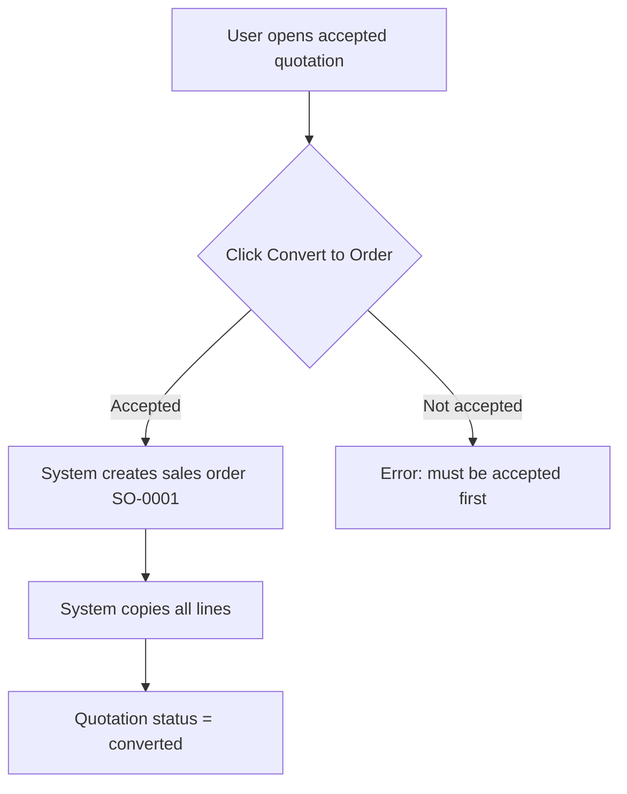
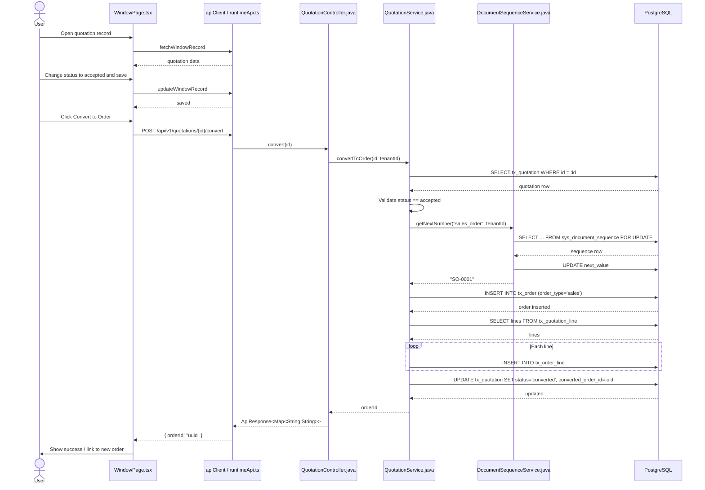

# Convert Quotation to Order

## Simple Instructions *(for non-developers)*

### What happens here?

This is how a sales representative turns an accepted quotation into a sales order without re-entering all the line items.

### Step-by-step *(what the user sees)*

1. You open the **Sales Quotations** window.
2. Find the quotation you want to convert.
3. Make sure the quotation status is **accepted**.
4. Click **Convert to Order**.
5. The system creates a new sales order (`SO-0001`) and copies all line items.
6. The quotation status changes to **converted** and shows the linked order.

### Diagram *(overview for non-developers)*

### Common issues

| Problem | What to do |
|---------|-------------|
| Convert button disabled | Change the quotation status to **accepted** first. |
| Order number missing | Check the `sales_order` document sequence in **Document Sequences**. |
| Already converted | The system prevents converting a quotation that is already converted. |

---

## Sequence Diagram *(technical)*

---

## Trigger

User clicks **Convert to Order** on a quotation record that has status `accepted`.

---

## Preconditions

- The quotation record exists in `tx_quotation`.
- Quotation status is `accepted`.
- The `sales_order` document sequence exists and is active.
- `tx_order` and `tx_order_line` tables exist.

---

## Flow Steps *(technical)*

### Step 1: Open and accept the quotation
- **File:** `frontend/src/routes/window/WindowPage.tsx`
- **What happens:** User opens the quotation, changes the status dropdown to `accepted`, and saves via the runtime update API.

### Step 2: Click Convert to Order
- **File:** `frontend/src/routes/window/WindowPage.tsx` (toolbar action)
- **HTTP:** `POST /api/v1/quotations/{id}/convert`
- **Called from:** frontend API client (`apiClient`)
- **Auth header:** Bearer token

### Step 3: Validate quotation status
- **File:** `backend/src/main/java/com/erp/modules/common/service/QuotationService.java:168`
- **What happens:** The service loads the quotation row and throws `IllegalStateException` if the status is not `accepted`.

### Step 4: Generate order number
- **File:** `backend/src/main/java/com/erp/modules/common/service/QuotationService.java:178`
- **What happens:** Calls `DocumentSequenceService.getNextNumber("sales_order", tenantId)` at `backend/src/main/java/com/erp/modules/common/service/DocumentSequenceService.java:32`, which locks and increments the `sales_order` sequence.

### Step 5: Create the sales order
- **File:** `backend/src/main/java/com/erp/modules/common/service/QuotationService.java:182`
- **Query:** `INSERT INTO tx_order (... order_type='sales' ...) VALUES (...)`
- **Tables hit:** `tx_order`

### Step 6: Copy quotation lines to order lines
- **File:** `backend/src/main/java/com/erp/modules/common/service/QuotationService.java:194`
- **Query:** `SELECT ... FROM tx_quotation_line WHERE quotation_id = :qid` then `INSERT INTO tx_order_line (...)`
- **Tables hit:** `tx_quotation_line`, `tx_order_line`

### Step 7: Mark quotation as converted
- **File:** `backend/src/main/java/com/erp/modules/common/service/QuotationService.java:213`
- **Query:** `UPDATE tx_quotation SET status='converted', converted_order_id=:oid WHERE id=:id`
- **Tables hit:** `tx_quotation`

### Step 8: Return the new order id
- **File:** `backend/src/main/java/com/erp/modules/common/controller/QuotationController.java:43`
- **Response:** `ApiResponse<Map<String,String>>` with `orderId`
- **Frontend behavior:** WindowPage shows success and optionally links to the new sales order.

---

## Postconditions

- A new `tx_order` record exists with `order_type = 'sales'` and a generated `order_number`.
- Corresponding `tx_order_line` records exist for each quotation line.
- The original quotation status is `converted` and `converted_order_id` points to the new order.

---

## Error Flows

### Quotation not accepted
- **Condition:** Quotation status is not `accepted`.
- **Backend response:** `409 CONFLICT` with message `"Quotation must be accepted before converting. Current status: ..."`
- **Frontend behavior:** Error dialog is shown; conversion is aborted.

### Already converted
- **Condition:** Quotation status is already `converted`.
- **Backend response:** `409 CONFLICT`
- **Frontend behavior:** Error dialog informs the user the quotation is already converted.

### Sequence not found
- **Condition:** The `sales_order` sequence is missing.
- **Backend response:** `404 NOT_FOUND`
- **Frontend behavior:** Conversion fails; user must check **Document Sequences**.
