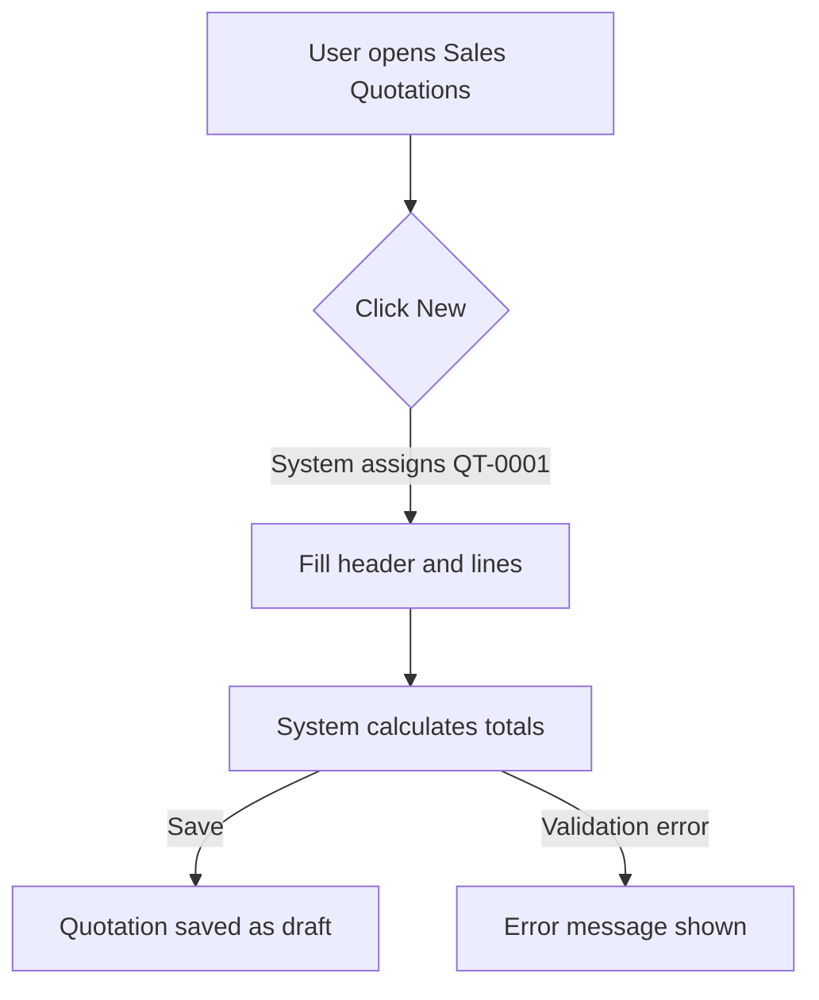
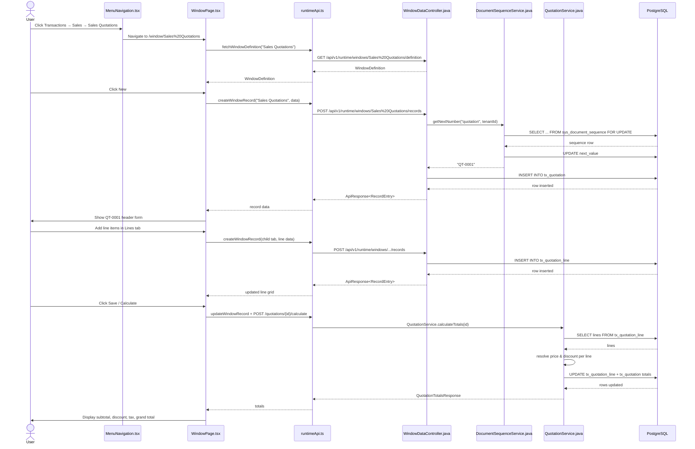

# Create Sales Quotation

## Simple Instructions *(for non-developers)*

### What happens here?

This is how a sales representative creates a formal price quote for a customer, adds line items, and saves it as a draft quotation.

### Step-by-step *(what the user sees)*

1. You are on the **Dashboard** or any page.
2. Click **Transactions → Sales → Sales Quotations** in the sidebar.
3. Click the **New** button.
4. The system creates a new quotation and assigns a number like `QT-0001`.
5. You select a customer and optional price list.
6. You open the **Lines** tab and add products with quantities.
7. The system shows the calculated subtotal, discount, tax, and grand total.
8. You click **Save**. The quotation is stored with status **draft**.

### Diagram *(overview for non-developers)*

### Common issues

| Problem | What to do |
|---------|-------------|
| Quote number not generated | Check **Administration → Document Sequences** and ensure `quotation` is active. |
| Customer not selectable | Verify the business partner record exists and is active. |
| Price is zero | Check that the product has a base price or is in a valid price list. |

---

## Sequence Diagram *(technical)*

---

## Trigger

User clicks **New** on the **Sales Quotations** window and fills in header and line data.

---

## Preconditions

- User is authenticated and has a valid JWT.
- User has access to the **Sales Quotations** window via `sys_window_access`.
- The `quotation` document sequence exists in `sys_document_sequence`.
- `tx_quotation` and `tx_quotation_line` tables exist.

---

## Flow Steps *(technical)*

### Step 1: Open the Sales Quotations window
- **File:** `frontend/src/core/runtime/components/MenuNavigation.tsx`
- **What happens:** User clicks the menu entry; React Router navigates to `/window/Sales%20Quotations`.

### Step 2: Load window definition
- **File:** `frontend/src/routes/window/WindowPage.tsx:36`
- **HTTP:** `GET /api/v1/runtime/windows/Sales%20Quotations/definition`
- **Called from:** `frontend/src/core/runtime/api/runtimeApi.ts`
- **What happens:** The page fetches the metadata definition (tabs, fields, sub-form config) for the Sales Quotations window.

### Step 3: Create the quotation header
- **File:** `frontend/src/core/runtime/api/runtimeApi.ts:117`
- **HTTP:** `POST /api/v1/runtime/windows/Sales%20Quotations/records`
- **Backend handler:** `WindowDataController` → calls runtime save logic
- **What happens:** The backend assigns a document number via `DocumentSequenceService.getNextNumber` at `backend/src/main/java/com/erp/modules/common/service/DocumentSequenceService.java:32` and inserts the row into `tx_quotation`.

### Step 4: Add quotation lines
- **File:** `frontend/src/routes/window/WindowPage.tsx` (child tab grid)
- **HTTP:** `POST /api/v1/runtime/windows/{childTabWindow}/records`
- **Backend handler:** `WindowDataController`
- **What happens:** Each line is inserted into `tx_quotation_line` with `quotation_id` set to the parent header id.

### Step 5: Calculate totals
- **File:** `backend/src/main/java/com/erp/modules/common/controller/QuotationController.java:25`
- **HTTP:** `POST /api/v1/quotations/{id}/calculate`
- **Backend handler:** `QuotationService.calculateTotals` at `backend/src/main/java/com/erp/modules/common/service/QuotationService.java:48`
- **What happens:** The service resolves price and discount per line, computes line totals, tax, and header totals, then persists the results to `tx_quotation_line` and `tx_quotation`.

### Step 6: Display updated totals
- **File:** `frontend/src/routes/window/WindowPage.tsx`
- **What happens:** The page re-renders the header form with the refreshed subtotal, discount, tax, and grand total fields.

---

## Postconditions

- A new `tx_quotation` record exists with status `draft` and a generated `quote_number`.
- Related `tx_quotation_line` records exist for each line item.
- Header totals (`subtotal`, `discount_amount`, `tax_amount`, `grand_total`) are persisted.

---

## Error Flows

### Sequence not found
- **Condition:** The `quotation` sequence is missing or inactive.
- **Backend response:** `404 NOT_FOUND` with message `"Sequence not found: quotation"`
- **Frontend behavior:** Save fails; error message is shown in the form or dialog.

### Validation failure
- **Condition:** Required fields such as `partner_id` or `quote_date` are missing.
- **Backend response:** `400 BAD_REQUEST` from runtime validation
- **Frontend behavior:** Field-level validation errors are displayed.

### Price resolution failure
- **Condition:** Product does not exist or has no price.
- **Backend response:** `404 NOT_FOUND` from `PriceResolutionService`
- **Frontend behavior:** Calculation fails; error message is shown.
