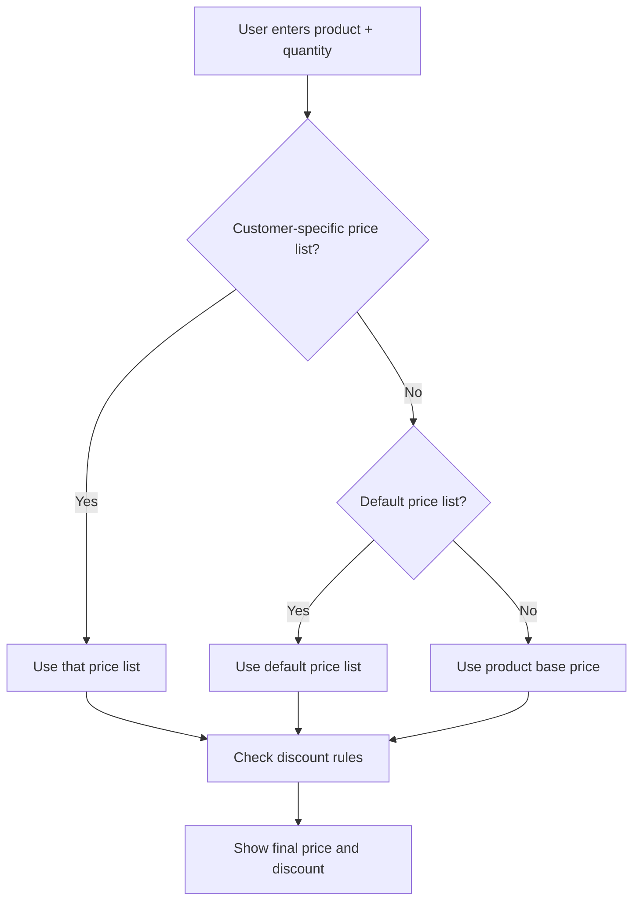
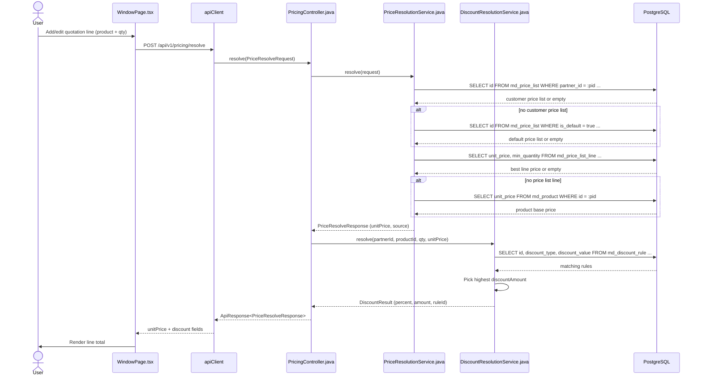

# Resolve Price and Discount

## Simple Instructions *(for non-developers)*

### What happens here?

This is how the system decides what price to show for a product on a quotation line and what discount to apply.

### Step-by-step *(what the user sees)*

1. You are creating or editing a quotation line.
2. You select a product and enter a quantity.
3. The system automatically looks up the best price:
   - First, a price list tied to the customer.
   - Second, the default price list.
   - Third, the product's base price.
4. The system then checks discount rules and applies the highest matching discount.
5. The line shows the final unit price, discount, and line total.

### Diagram *(overview for non-developers)*

### Common issues

| Problem | What to do |
|---------|-------------|
| Price is too high | Check customer-specific and default price lists for the product. |
| Discount missing | Verify discount rules cover the product, customer, quantity, and current date. |
| Volume price ignored | Ensure the quantity meets the `min_quantity` on the price list line. |

---

## Sequence Diagram *(technical)*

---

## Trigger

User adds or updates a line item on a quotation (or any future feature that calls the pricing endpoint).

---

## Preconditions

- Product exists in `md_product`.
- Request includes `productId`, optional `partnerId`, and `quantity`.
- User is authenticated and belongs to a tenant.

---

## Flow Steps *(technical)*

### Step 1: User enters line data
- **File:** `frontend/src/routes/window/WindowPage.tsx` (child tab inline grid)
- **What happens:** User selects a product and enters a quantity in the quotation line grid.

### Step 2: Frontend calls pricing endpoint
- **File:** `backend/src/main/java/com/erp/modules/common/controller/PricingController.java:39`
- **HTTP:** `POST /api/v1/pricing/resolve`
- **Request body:** `{ productId, partnerId, quantity }`
- **Auth header:** Bearer token

### Step 3: Resolve price list (customer-specific)
- **File:** `backend/src/main/java/com/erp/modules/common/service/PriceResolutionService.java:81`
- **Query:** `SELECT id FROM md_price_list WHERE partner_id = :pid AND is_active = true AND valid_from <= :today AND valid_to >= :today LIMIT 1`
- **Tables hit:** `md_price_list`

### Step 4: Fallback to default price list
- **File:** `backend/src/main/java/com/erp/modules/common/service/PriceResolutionService.java:92`
- **Query:** `SELECT id FROM md_price_list WHERE is_default = true AND is_active = true ... LIMIT 1`
- **Tables hit:** `md_price_list`

### Step 5: Resolve best line price
- **File:** `backend/src/main/java/com/erp/modules/common/service/PriceResolutionService.java:101`
- **Query:** `SELECT unit_price, min_quantity FROM md_price_list_line WHERE price_list_id = :plid AND product_id = :pid AND min_quantity <= :qty ORDER BY min_quantity DESC NULLS LAST LIMIT 1`
- **Tables hit:** `md_price_list_line`

### Step 6: Fallback to product base price
- **File:** `backend/src/main/java/com/erp/modules/common/service/PriceResolutionService.java:114`
- **Query:** `SELECT unit_price FROM md_product WHERE id = :pid AND is_active = true LIMIT 1`
- **Tables hit:** `md_product`

### Step 7: Resolve discount
- **File:** `backend/src/main/java/com/erp/modules/common/service/DiscountResolutionService.java:34`
- **Query:** `SELECT id, discount_type, discount_value FROM md_discount_rule WHERE is_active = true AND (partner_id = :pid OR partner_id IS NULL) AND (product_id = :prd OR product_id IS NULL) AND (min_quantity IS NULL OR min_quantity <= :qty) AND (valid_from <= :today AND valid_to >= :today)`
- **Tables hit:** `md_discount_rule`

### Step 8: Return combined response
- **File:** `backend/src/main/java/com/erp/modules/common/controller/PricingController.java:60`
- **Response:** `ApiResponse<PriceResolveResponse>` containing `unitPrice`, `source`, `discountPercent`, `discountAmount`, `discountRuleId`

---

## Postconditions

- Frontend receives the resolved unit price and discount for the line.
- Line total can be calculated as `quantity × unitPrice − discountAmount`.

---

## Error Flows

### Product not found
- **Condition:** `productId` does not exist or is inactive.
- **Backend response:** `404 NOT_FOUND` with `"Product not found: ..."`
- **Frontend behavior:** Field error or dialog is shown.

### Unauthenticated
- **Condition:** Missing or invalid JWT, or missing tenant context.
- **Backend response:** `401 UNAUTHORIZED` with `"Authentication required."`
- **Frontend behavior:** User is redirected to login.

### No matching price
- **Condition:** No price list line and no product base price.
- **Backend response:** `404 NOT_FOUND`
- **Frontend behavior:** Line cannot be priced; user checks product setup.
