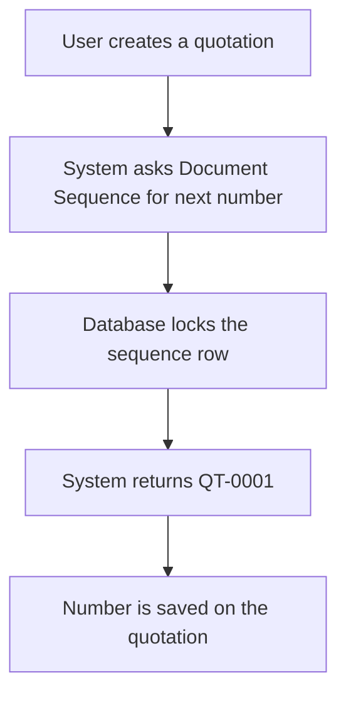

# Document Sequence Service

## Purpose

Generates sequential, tenant-scoped document numbers such as `QT-0001`, `SO-0001`, and `INV-0001` for ERP business documents. It stores sequence configuration in `sys_document_sequence` and uses database-level pessimistic locking so concurrent requests never receive duplicate numbers.

---

## Simple Instructions *(for non-developers)*

### What is this?

This is the part of the system that automatically creates professional document numbers. Instead of typing an order or quotation number by hand, the system assigns the next available number according to a predefined pattern.

### What can you do here?

- View and configure document sequence rules (prefix, next value, padding) from the **Administration → Document Sequences** window.
- The system automatically assigns numbers when you create quotations, sales orders, and other documents.
- Peek at the next number that will be used without actually using it.

### How to use it

1. Go to **Administration → Document Sequences** in the sidebar.
2. Open a sequence such as `quotation` or `sales_order`.
3. Review or edit the prefix (for example `QT-`), next value, and padding.
4. Save your changes.
5. When you create a new quotation or sales order, the system assigns the next number automatically.

### Diagram

### Common issues

| Problem | Solution |
|---------|----------|
| Document number is missing | Check that the sequence exists in **Document Sequences** and is active. |
| Two users get the same number | This should not happen; report it if it does, because the database lock may be misconfigured. |
| Sequence not found error | Verify the sequence name matches the one configured in **Document Sequences**. |

---

## Key Classes *(developers)*

| Class | Role |
|-------|------|
| `DocumentSequenceController` | REST endpoints for `next` and `peek` operations |
| `DocumentSequenceService` | Business logic: formats numbers, increments counters, handles tenant scope |
| `DocumentSequence` | JPA entity mapped to `sys_document_sequence` |
| `DocumentSequenceRepository` | JPA repository with pessimistic-write `findForUpdate` query |
| `DocumentNumberResponse` | DTO returned by the controller |

---

## API Endpoints

| Method | Path | Handler | Auth |
|--------|------|---------|------|
| POST | `/api/v1/sequences/{name}/next` | `DocumentSequenceController.getNext` | JWT + tenant context |
| GET | `/api/v1/sequences/{name}/peek` | `DocumentSequenceController.peekNext` | JWT + tenant context |

### Responses

- `POST .../next` → `ApiResponse<DocumentNumberResponse>` with `documentNumber: "QT-0001"`
- `GET .../peek` → `ApiResponse<DocumentNumberResponse>` with `nextNumber: "QT-0002"`
- `404 NOT_FOUND` if the sequence name does not exist
- `401 UNAUTHORIZED` if the request lacks a valid JWT or tenant context

---

## Dependencies

- `DocumentSequenceRepository` — pessimistic-lock sequence lookup and persistence
- `RuntimeContextHolder` — provides the current tenant id from the JWT
- PostgreSQL — sequence row locking via `SELECT ... FOR UPDATE`

---

## Related Frontend

- Form rendering: `frontend/src/routes/window/WindowPage.tsx` displays the **Document Sequences** admin window.
- Runtime API: `frontend/src/core/runtime/api/runtimeApi.ts` performs generic CRUD for the metadata-driven form.
- Menu navigation: `frontend/src/core/runtime/components/MenuNavigation.tsx` loads the **Administration → Document Sequences** menu entry from `/api/v1/menu`.
