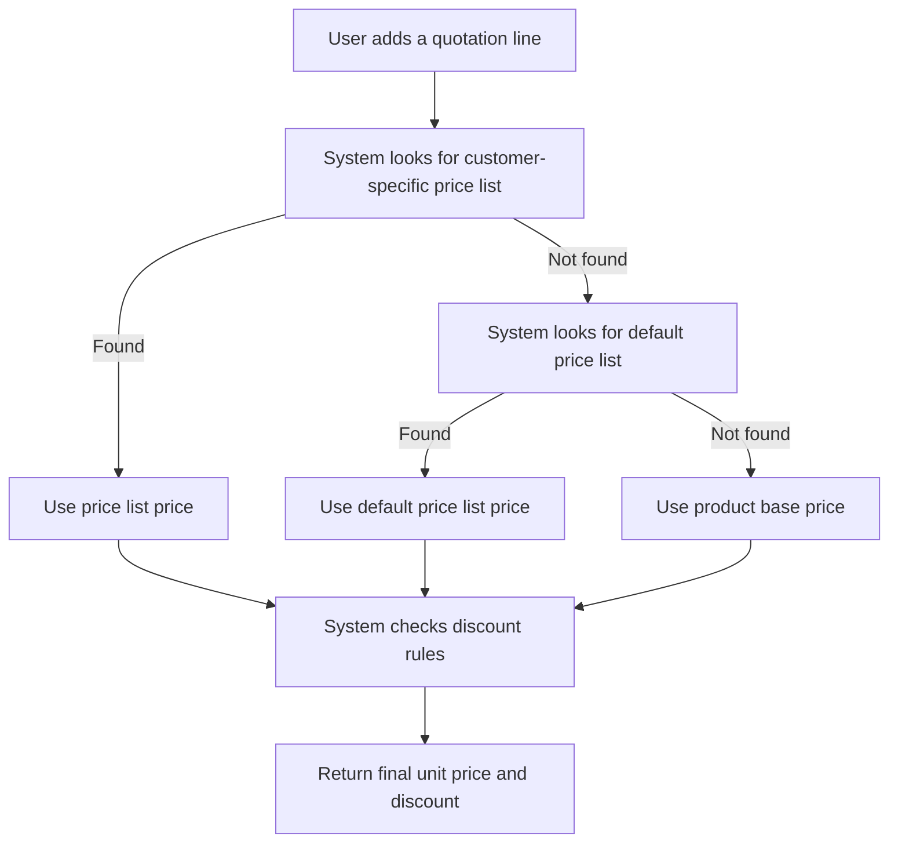

# Pricing Service

## Purpose

Resolves the best unit price for a product/customer/quantity combination by walking a fallback chain from customer-specific price lists to default price lists and finally to the product base price. It also finds and applies the highest matching discount rule (percentage or fixed amount) for the same context.

---

## Simple Instructions *(for non-developers)*

### What is this?

This is the part of the system that decides how much to charge a customer for a product. It checks special price lists, volume prices, and discount rules automatically.

### What can you do here?

- Create **Price Lists** under **Master Data → Price Lists** with product-specific or volume-based prices.
- Create **Discount Rules** under **Master Data → Discount Rules** for customer-specific or volume-based discounts.
- When a quotation line is entered, the system picks the best price and discount without manual calculation.

### How to use it

1. Go to **Master Data → Price Lists** and create a price list.
2. Add lines to the price list: choose a product, minimum quantity, and unit price.
3. Go to **Master Data → Discount Rules** and create a rule (percentage or fixed amount).
4. Open **Transactions → Sales → Sales Quotations** and create a new quotation.
5. Add a line item. The system automatically resolves the unit price and applies the best discount.

### Diagram



### Common issues

| Problem | Solution |
|---------|----------|
| Price is higher than expected | Check whether a customer-specific price list exists and is still valid. |
| Discount not applied | Verify the discount rule matches the customer, product, quantity, and date range. |
| Wrong price list used | Only one active default price list should exist; deactivate duplicates. |

---

## Key Classes *(developers)*

| Class | Role |
|-------|------|
| `PricingController` | REST endpoint that combines price and discount resolution |
| `PriceResolutionService` | Resolves price from customer price list → default price list → product base price |
| `DiscountResolutionService` | Finds the highest applicable discount rule and calculates discount amount |
| `PriceResolveRequest` | Input DTO: productId, partnerId, quantity |
| `PriceResolveResponse` | Output DTO: unitPrice, source, discountPercent, discountAmount, discountRuleId |

---

## API Endpoints

| Method | Path | Handler | Auth |
|--------|------|---------|------|
| POST | `/api/v1/pricing/resolve` | `PricingController.resolve` | JWT + tenant context |

### Request body

```json
{
  "productId": "uuid",
  "partnerId": "uuid",
  "quantity": 5
}
```

### Response

```json
{
  "unitPrice": 1200.00,
  "priceListId": "uuid",
  "source": "default_price_list",
  "discountPercent": 10.00,
  "discountAmount": 600.00,
  "discountRuleId": "uuid"
}
```

---

## Dependencies

- `NamedParameterJdbcTemplate` — direct SQL queries against `md_price_list`, `md_price_list_line`, `md_discount_rule`, and `md_product`
- `PriceResolutionService` in-memory cache — 5-minute TTL, 500-entry eviction
- Runtime context — tenant isolation enforced in SQL `WHERE` clauses

---

## Related Frontend

- Quotation and line forms are rendered through `frontend/src/routes/window/WindowPage.tsx`.
- Generic runtime CRUD is handled by `frontend/src/core/runtime/api/runtimeApi.ts`.
- The pricing endpoint is called server-side during quotation line/total calculation; there is no dedicated frontend pricing component.
