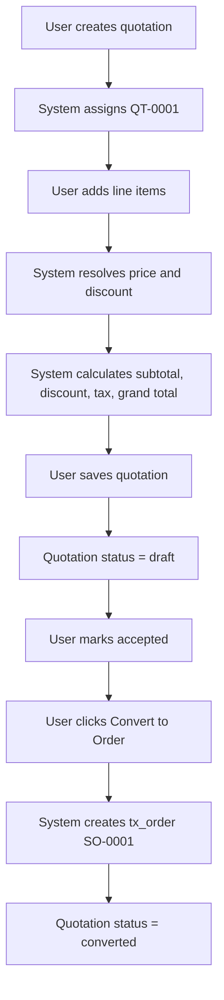

# Quotation Service

## Purpose

Calculates quotation line and header totals by resolving prices and discounts for each line, persists the results, and converts an accepted quotation into a sales order (`tx_order` with `order_type = 'sales'`).

---

## Simple Instructions *(for non-developers)*

### What is this?

This is the part of the system that handles sales quotations. It calculates line totals, header totals (subtotal, discount, tax, grand total), and turns an accepted quotation into a sales order with one click.

### What can you do here?

- Create and edit **Sales Quotations** from **Transactions → Sales → Sales Quotations**.
- Add line items; the system calculates unit price, discount, and line total automatically.
- Change the quotation status through its lifecycle: draft → sent → accepted → converted.
- Convert an accepted quotation to a sales order.

### How to use it

1. Go to **Transactions → Sales → Sales Quotations**.
2. Click **New** to create a quotation. The system assigns a quote number such as `QT-0001`.
3. Select a customer and optional price list.
4. Open the **Lines** tab and add products with quantities.
5. Save the quotation (status = **draft**).
6. When the customer accepts, change the status to **accepted**.
7. Click **Convert to Order**. The system creates a sales order (`SO-0001`) and links it to the quotation.

### Diagram



### Common issues

| Problem | Solution |
|---------|----------|
| Convert to Order button does nothing | The quotation must be in **accepted** status before conversion. |
| Line totals look wrong | Check the price list and discount rule; click **Calculate** to refresh. |
| Quotation number missing | Verify the `quotation` document sequence is active and has a prefix. |

---

## Key Classes *(developers)*

| Class | Role |
|-------|------|
| `QuotationController` | REST endpoints for calculate, calculate-line, and convert |
| `QuotationService` | Business logic: totals calculation and quote-to-order conversion |
| `PriceResolutionService` | Resolves unit price per line |
| `DiscountResolutionService` | Resolves discount per line |
| `DocumentSequenceService` | Generates the sales order number during conversion |
| `LineCalcRequest` / `LineCalcResponse` | DTOs for single-line preview calculation |
| `QuotationTotalsResponse` | DTO for header totals |

---

## API Endpoints

| Method | Path | Handler | Auth |
|--------|------|---------|------|
| POST | `/api/v1/quotations/{id}/calculate` | `QuotationController.calculate` | JWT + tenant context |
| POST | `/api/v1/quotations/calculate-line` | `QuotationController.calculateLine` | JWT + tenant context |
| POST | `/api/v1/quotations/{id}/convert` | `QuotationController.convert` | JWT + tenant context |

### Calculate totals response

```json
{
  "subtotal": 2400.00,
  "discountAmount": 240.00,
  "taxAmount": 216.00,
  "grandTotal": 2376.00
}
```

### Convert response

```json
{
  "orderId": "uuid"
}
```

---

## Dependencies

- `NamedParameterJdbcTemplate` — reads/writes `tx_quotation` and `tx_quotation_line`
- `PriceResolutionService` — per-line unit price
- `DiscountResolutionService` — per-line discount
- `DocumentSequenceService` — sales order number generation
- Runtime context — tenant isolation

---

## Related Frontend

- Quotation forms are rendered through `frontend/src/routes/window/WindowPage.tsx`.
- Generic runtime CRUD is handled by `frontend/src/core/runtime/api/runtimeApi.ts`.
- Custom quotation actions (calculate, convert) are intended to be wired to form toolbar actions in the metadata definition.
